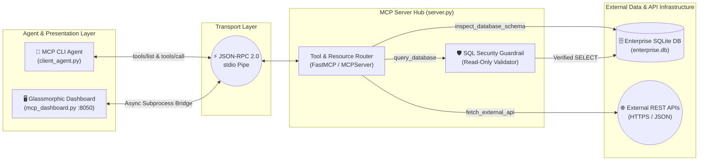

# ⚡ MCP Nexus: Autonomous Agent-to-API & Database Command Center

<div align="center">


**A production-grade Model Context Protocol (MCP) server, autonomous CLI client agent, and real-time Glassmorphic telemetry dashboard for bridging AI agents with relational databases and external REST APIs.**

[Architecture](#-system-architecture) • [MCP Tool Registry](#-mcp-tool--resource-registry) • [Glassmorphic UI](#-glassmorphic-telemetry-command-center) • [Security Guardrails](#-security--resilience-engineering) • [Quickstart](#-quickstart--execution)

</div>

---

## 📖 Overview

Modern AI agents require standardized, secure, and observable access to enterprise data sources without brittle, hardcoded wrapper scripts. **MCP Nexus** implements the **Model Context Protocol (MCP)** to expose local relational databases (**SQLite3**) and live external **REST microservices** through a unified `stdio` JSON-RPC 2.0 transport layer.

In addition to a headless CLI agent (`client_agent.py`), the project features an interactive **Glassmorphic Web Command Center** (`mcp_dashboard.py`) with animated SVG packet routing, real-time latency telemetry, SQL injection/mutation guardrails, and a 1-click automated walkthrough designed for live technical demonstrations.

---

## 🏗️ System Architecture



---

## 🧰 MCP Tool & Resource Registry

The MCP server (`server.py`) dynamically exposes structured JSON schemas for tool discovery and execution:

| Capability Name | Type | Input Parameters | Description & Behavior | Security Policy |
| :--- | :---: | :--- | :--- | :--- |
| `inspect_database_schema` | **Tool** | `None` | Queries `sqlite_master` to return all table names and DDL column definitions in `enterprise.db`. | Read-Only Metadata |
| `query_database` | **Tool** | `sql_query: str` | Executes parameterized SQL queries against the enterprise database and serializes rows into structured JSON. | **Strict `SELECT` Only** (Blocks `DROP`, `DELETE`, `UPDATE`, `ALTER`) |
| `fetch_external_api` | **Tool** | `endpoint_url: str`<br/>`query_params: dict` | Dispatches HTTP `GET` requests to external REST APIs with custom user-agent headers and timeout protection. | 10.0s Socket Timeout |
| `db://enterprise/summary` | **Resource** | `URI` | Provides high-level contextual metadata describing the `employees` and `system_metrics` tables. | Static Context URI |

---

## 🖥️ Glassmorphic Telemetry Command Center

To provide full visibility into agent-to-server communication, `mcp_dashboard.py` serves a zero-dependency web interface at `http://localhost:8050`:

* **Frosted Glassmorphic UI & Translucent Navbar**: Built with multi-layered `backdrop-filter: blur(24px)` surfaces, ambient radial glow orbs, and responsive CSS grid layouts.
* **Animated SVG Architecture Topology**: Real-time SVG vector paths with glowing JSON-RPC 2.0 data packets that dynamically highlight either the **SQLite Database branch** or the **REST API Gateway branch** based on active tool execution.
* **1-Click Automated Demo Mode**: Built-in presentation sequencer (`Run Automated Demo`) that automatically cycles through schema introspection, analytical SQL execution, destructive query blocking, and live REST API fetching.
* **Live JSON-RPC 2.0 Wire Inspector**: Logs every `tools/call` method invocation, parameter payload, execution mode, and millisecond latency timestamp.

---

## 🛡️ Security & Resilience Engineering

1. **Deterministic SQL Mutation Shield**:
   Before any query touches the SQLite cursor, `query_database` normalizes and validates the statement prefix. Any attempt by an LLM or user to execute DDL/DML mutations (e.g., `DROP TABLE employees;`) is intercepted and rejected with a structured security violation payload.
2. **Cross-Version MCP SDK Compatibility**:
   Seamlessly supports both **MCP Python SDK v2.x** (`mcp.server.MCPServer`) and **MCP Python SDK v1.x** (`mcp.server.fastmcp.FastMCP`) via dynamic runtime resolution, preventing environment breakage across virtual environments.
3. **Zero-Config Database Auto-Seeding**:
   On startup, `init_and_seed_db()` automatically provisions `enterprise.db` with two production-style tables (`employees` and `system_metrics`) so the system is immediately testable out of the box.

---

## 📂 Repository Structure

```text
mcp-nexus-agent/
├── server.py            # Core MCP Server exposing DB & REST API tools over stdio
├── client_agent.py      # Autonomous CLI MCP Client performing handshake & tool execution
├── mcp_dashboard.py     # Glassmorphic Web Command Center with animated SVG telemetry
├── enterprise.db        # Auto-generated SQLite3 database (seeded on first run)
├── requirements.txt     # Python package dependencies
├── .gitignore           # Git exclusion rules for virtual environments and local artifacts
└── README.md            # Project documentation and architectural specification
```

---

## 🚀 Quickstart & Execution

### 1. Clone the Repository & Install Dependencies
```bash
git clone [https://github.com/SyedRazaZaidi/mcp-nexus-agent.git](https://github.com/SyedRazaZaidi/mcp-nexus-agent.git)
cd mcp-nexus-agent
pip install -r requirements.txt
```

### 2. Launch the Glassmorphic Web Dashboard (Recommended for Demos)
```bash
python mcp_dashboard.py
```
* Automatically opens **`http://localhost:8050`** in your default browser.
* Click **"Run Automated Demo"** in the top-right navigation bar to watch the full 4-stage pipeline execute live.

### 3. Run the Headless CLI Agent
```bash
python client_agent.py
```
**Sample CLI Output:**
```text
1. [Agent] Connecting to MCP Server over stdio...
   -> Handshake complete!

2. [Agent] Discovered 3 MCP Tools:
   - inspect_database_schema: List all tables and their column schemas in the enterprise SQLite database.
   - query_database: Execute a read-only SQL SELECT query against the enterprise SQLite database.
   - fetch_external_api: Fetch live JSON/text data from an external REST API endpoint via HTTP GET.

3. [Agent -> Tool: inspect_database_schema]
   [ { "table": "employees", ... }, { "table": "system_metrics", ... } ]

4. [Agent -> Tool: query_database] Executing: SELECT name, role, salary FROM employees WHERE department = 'AI Engineering' ORDER BY salary DESC
   { "row_count": 2, "data": [ { "name": "Ali Khan", "role": "Lead ML Architect", "salary": 185000.0 }, ... ] }

5. [Agent -> Tool: query_database] Testing Security Guardrail: DROP TABLE employees;
   { "error": "Security Policy Violation: Only SELECT statements are permitted." }

6. [Agent -> Tool: fetch_external_api] GET [https://jsonplaceholder.typicode.com/users/1](https://jsonplaceholder.typicode.com/users/1)
   { "id": 1, "name": "Leanne Graham", "username": "Bret", "email": "Sincere@april.biz", ... }
```

---

## 📡 Sample JSON-RPC 2.0 Protocol Trace

**Request (`Client -> Server`)**
```json
{
  "jsonrpc": "2.0",
  "id": 2,
  "method": "tools/call",
  "params": {
    "name": "query_database",
    "arguments": {
      "sql_query": "SELECT name, role, salary FROM employees WHERE department = 'AI Engineering' ORDER BY salary DESC"
    }
  }
}
```

**Response (`Server -> Client`)**
```json
{
  "jsonrpc": "2.0",
  "id": 2,
  "result": {
    "content": [
      {
        "type": "text",
        "text": "{\n  \"row_count\": 2,\n  \"data\": [\n    {\n      \"name\": \"Ali Khan\",\n      \"role\": \"Lead ML Architect\",\n      \"salary\": 185000.0\n    },\n    {\n      \"name\": \"Zainab Raza\",\n      \"role\": \"Computer Vision Engineer\",\n      \"salary\": 155000.0\n    }\n  ]\n}"
      }
    ],
    "isError": false
  }
}
```

---

## 👨‍💻 Author

**Syed Raza Abbas Zaidi**  
*Bachelor of Science in Artificial Intelligence (BS-AI)*  
GitHub: [@SyedRazaZaidi](https://github.com/SyedRazaZaidi)

---

## 📄 License

This project is licensed under the **MIT License**.
